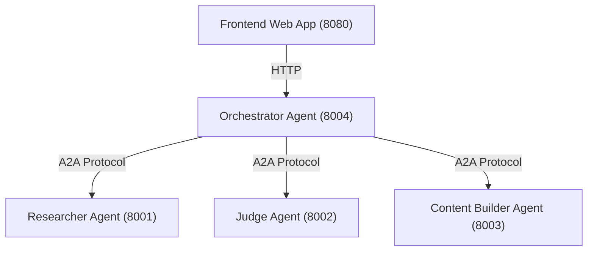

# course-creation-agent (Distributed)

A multi-agent system built with Google's Agent Development Kit (ADK) and Agent-to-Agent (A2A) protocol. It orchestrates a team of microservice agents to research, evaluate (judge), and build course content.

## Overview

This project is a distributed multi-agent system that automates the generation of high-quality courses. It orchestrates several specialized microservices, each running as an independent agent (Orchestrator, Researcher, Judge, Content Builder). 

## Architecture

This project uses a distributed microservices architecture where each agent runs independently and communicates via the A2A protocol.



* **Orchestrator Service:** The main entry point. Manages workflows using `LoopAgent` and `SequentialAgent`, and delegates tasks to other agents.
* **Researcher Service:** Gathers information using Google Search.
* **Judge Service:** Evaluates the quality of the researched content.
* **Content Builder Service:** Compiles the final course content.
* **Agent App:** A web frontend application that interacts with the Orchestrator to display progress and results.

## Tech Stack


## Prerequisites

* Python 3.10+
* `uv` package manager
* Google Cloud SDK (`gcloud` CLI)

## Installation

1. Clone the repository and navigate to the root directory.
2. Install the project dependencies:
```bash
uv sync
```
3. Authenticate with Google Cloud to configure Application Default Credentials (ADC):
```bash
gcloud auth application-default login
```
4. Configure environment variables. Copy the example configuration:
```bash
cp .env.example .env
```

## Configuration

The system uses a `.env` file for configuration. Below are the verified environment variables:

| Variable | Required | Description | Default |
| -------- | -------- | ----------- | ------- |
| `GEMINI_API_KEY` | No | API key for Google Gemini | _(None)_ |
| `MODEL` | No | Default global fallback model | `gemini-2.5-flash` |
| `RESEARCHER_MODEL` | No | Specific model for the Researcher agent | `gemini-2.5-flash` |
| `JUDGE_MODEL` | No | Specific model for the Judge agent | `gemini-2.5-flash` |
| `CONTENT_BUILDER_MODEL` | No | Specific model for the Content Builder agent | `gemini-2.5-flash` |
| `MODEL_ROUTING` | No | JSON dictionary mapping primary models to fallback options during high traffic/errors | `{"gemini-8-flash": ["gemini-2.5-pro", "gemini-2.5-flash"]}` |
| `RESEARCHER_AGENT_CARD_URL` | No | Resolution URL for the Researcher agent | `http://localhost:8001/a2a/agent/.well-known/agent-card.json` |
| `JUDGE_AGENT_CARD_URL` | No | Resolution URL for the Judge agent | `http://localhost:8002/a2a/agent/.well-known/agent-card.json` |
| `CONTENT_BUILDER_AGENT_CARD_URL` | No | Resolution URL for the Content Builder agent | `http://localhost:8003/a2a/agent/.well-known/agent-card.json` |
| `AGENT_SERVER_URL` | No | URL of the Orchestrator service accessed by the App | `http://localhost:8004` |
| `FRONTEND_PORT` | No | Port on which the frontend app will run | `8080` |

## Usage

You can start the entire stack locally using the provided runner scripts. These scripts launch all four agent microservices and the web app simultaneously.

**For Unix/macOS:**
```bash
./run_local.sh
```

**For Windows:**
```powershell
.\run_local.ps1
```

Once started, the services will run at the following locations:
- **Web App UI:** `http://localhost:8080`
- Researcher Agent: `http://localhost:8001`
- Judge Agent: `http://localhost:8002`
- Content Builder: `http://localhost:8003`
- Orchestrator Agent: `http://localhost:8004`

Press `Ctrl+C` in your terminal to cleanly terminate all processes.

## Project Structure

* `agents/` - Source code for microservice agents (`orchestrator`, `researcher`, `judge`, `content_builder`).
* `app/` - Frontend web application.
* `local_run/` - Auto-generated working directories for local agent runtime configs.
* `shared/` - Shared files used by all agents (linked via symlinks to avoid duplication).
* `tests/` - Project test suite.

## Testing

Run tests and static analysis commands via `uv`:

```bash
# Run unit tests
uv run pytest

# Run linter (Ruff)
uv run ruff check

# Run type checker (MyPy)
uv run mypy .

# Run spell checking
uv run codespell
```

## Deployment

To deploy to Google Cloud Run, each service must be deployed individually.
1. Deploy `agents/researcher`, `agents/judge`, `agents/content_builder`, and `agents/orchestrator` as separate Cloud Run services.
2. Deploy the `app/` directory as the frontend Cloud Run service.
3. Configure the `app` service with the `AGENT_SERVER_URL` mapping to the Orchestrator URL, and update the `<SERVICE>_AGENT_CARD_URL` variables to map to their respective deployed Cloud Run URLs.
